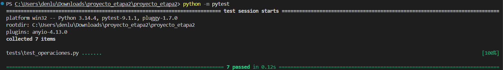

# Gestor de Contenidos y Recomendador de Streaming — Etapa 2

Sistema de consola en Python que registra las reproducciones de cada usuario sobre un catálogo de películas por género, recomienda el próximo título, genera reportes y alertas, y **conserva los datos entre ejecuciones** (CSV + JSON + TXT). Se verifica con pruebas unitarias.

## Ejecución

```bash
python main.py              # programa principal
python -m unittest -v       # pruebas unitarias (desde esta carpeta)
```

Usuarios de demostración (en `usuarios.csv`): `manuela` / `manuela`, `Robert` / `clave`, `lucia_89` / `lucia2026`.
`historial.csv` trae 28 reproducciones para probar filtros, reportes y alertas.

## Estructura

| Archivo | Función |
|---|---|
| `main.py` | Menús e interacción (única parte con `input`/`print` de flujo) |
| `operaciones.py` | Lógica del dominio: usuarios, búsqueda, recomendación, insignias, alertas, reportes |
| `validaciones.py` | Expresiones regulares, validación de configuración y excepciones propias |
| `archivos.py` | Lectura/escritura de CSV, JSON y TXT |
| `configuracion.json` | Géneros, umbrales de experto, parámetros de alertas y regex |
| `usuarios.csv`, `catalogo.csv`, `historial.csv` | Datos persistentes |
| `reporte.txt` | Salida legible generada por el programa (Menú de reportes → opción 5) |
| `tests/test_operaciones.py` | 7 pruebas unitarias |
| `evidencia_pruebas.txt` | Salida de la ejecución de las pruebas |

No se usan variables globales: las rutas y la configuración se pasan por parámetro.

## Cambios respecto de la Etapa 1

| Etapa 1 | Etapa 2 | Limitación que resuelve |
|---|---|---|
| Datos hardcodeados en `datos.py` | `configuracion.json` + `catalogo.csv` + `usuarios.csv` | Cambiar géneros, umbrales o catálogo sin tocar el código |
| `usuarios` y `contraseñas` como listas paralelas | Diccionario `{usuario: contraseña}` | Dependencia frágil de índices y pérdida de usuarios al cerrar |
| `matriz` usuario × género | Diccionario acumulador `{usuario: {género: cantidad}}` calculado desde el historial | Filas atadas a la posición, sin nombres de campo |
| `peliculas_vistas` (lista de listas) | `historial.csv` (una fila por reproducción, con fecha) + conjunto de títulos vistos por usuario | Se perdía el historial y no había fecha |
| `usuarios.index(usuario)` repetido | Acceso directo por clave | Código repetido y propenso a errores |
| Solo se validaba "campo vacío" | Regex + excepciones propias | Formatos inválidos aceptados |
| Todo en `main.py` + `operaciones.py` | Separación en 4 módulos | Mezcla de interacción, lógica y datos |
| Catálogo en 5 listas (`comedia`, `romcom`, ...) | Una lista de diccionarios `{titulo, genero, anio}` | Funciones con 5 parámetros de listas; agregar un género obligaba a cambiar el código |
| `buscar_pelicula` devolvía un índice (-1 si no existía) | Devuelve el registro de la película o `None` | Código del menú dependía de posiciones |

Se **reutilizan** de la Etapa 1: el problema, los 5 géneros, las 50 películas, los usuarios precargados, la regla de recomendación, el umbral de experto (8) y los nombres de las funciones.

## Formato de los archivos

Todos los CSV usan coma, UTF-8, encabezado en la primera línea y orden de campos fijo (títulos con comas, como `"Con amor, Simon"`, se escriben entre comillas automáticamente con el módulo `csv`).

```
usuarios.csv   → usuario,contrasena
catalogo.csv   → titulo,genero,anio
historial.csv  → usuario,titulo,genero,fecha        (fecha AAAA-MM-DD)
```

- `usuarios.csv` e `historial.csv` se crean con su encabezado si no existen.
- `catalogo.csv` y `configuracion.json` son **obligatorios**: si faltan o son inválidos, el programa informa y se detiene (no se reemplazan en silencio).
- Una fila incorrecta (campos faltantes o vacíos, fecha inexistente, usuario o título que no existen, género que no coincide con el catálogo) se informa con su número de línea y se descarta sin perder las demás.
- Si no hay usuarios, el login informa que no hay usuarios registrados y se puede crear uno desde el menú principal.

## `configuracion.json`

```json
{
  "generos": ["Comedia", "Romcom", "Terror", "Suspenso", "Ciencia ficcion"],
  "umbral_experto": {"Comedia": 8, "Romcom": 8, "Terror": 8, "Suspenso": 8, "Ciencia ficcion": 8},
  "alertas": {
    "concentracion_max_pct": 70,
    "concentracion_min_reproducciones": 5,
    "genero_min_reproducciones": 2
  },
  "formatos": {
    "usuario": "[A-Za-z0-9_]{3,15}",
    "fecha": "\\d{4}-\\d{2}-\\d{2}",
    "contrasena": "\\S{6,}"
  }
}
```

El orden de `generos` se usa para desempatar. Es configuración inválida: archivo ausente, JSON mal formado, clave faltante, género sin umbral, umbral no numérico o negativo, porcentaje fuera de 1–100 o regex que no compila.

## Validaciones con expresiones regulares

Se aplican con `re.fullmatch` (el patrón debe cubrir todo el texto) y se leen del JSON.

| Dato | Regex | Verificación posterior |
|---|---|---|
| Usuario | `[A-Za-z0-9_]{3,15}` | No debe existir ya |
| Fecha | `\d{4}-\d{2}-\d{2}` | Fecha real con `datetime.strptime` (rechaza `2026-02-30`) |
| Contraseña | `\S{6,}` | Sin comas (para respetar el CSV) |

Se usa `[A-Za-z0-9_]` y no `\w` porque `\w` acepta acentos y otros caracteres Unicode. La regla de contraseña se aplica **solo al crear usuarios**, no al cargar `usuarios.csv`; por eso `Robert` (clave de 5 caracteres) se conserva sin cambios.

## Recomendación

1. Género favorito = el de más reproducciones totales del usuario (las repetidas cuentan).
2. Empate → gana el que aparece primero en `generos`.
3. Se recomienda la primera película del catálogo (orden del archivo) de ese género cuyo título no esté en el conjunto de títulos vistos.
4. Si el género favorito está agotado, se pasa al siguiente del ranking que tenga películas no vistas. Si no queda ninguna, se informa.
5. Usuario sin historial → no se recomienda.

**Insignias:** por películas **distintas** vistas en el género (`>=` umbral). Ver la misma película otra vez no suma.

## Alertas (`reporte.txt` y menú de reportes)

| Alerta | Condición |
|---|---|
| `CONCENTRACION` | Usuario con al menos `concentracion_min_reproducciones` reproducciones y **más de** `concentracion_max_pct` % en un solo género (70 % exacto no dispara) |
| `GENERO_DEBIL` | Un género con menos de `genero_min_reproducciones` reproducciones en toda la plataforma (incluye los de 0) |
| `CATALOGO_AGOTADO` | Usuario con reproducciones que vio todo el catálogo de su género favorito |

La insignia de experto no es una alerta: aparece como dato informativo en el reporte.

## Diccionarios y conjuntos

- **Diccionario de registro:** cada fila de CSV se convierte en `{"usuario", "titulo", "genero", "fecha"}`.
- **Diccionario acumulador:** `{usuario: {género: cantidad}}` y `{género: cantidad}`.
- **Diccionario de configuración:** el contenido de `configuracion.json`.
- **Conjuntos:** títulos vistos por usuario (recomendación), películas distintas por género (insignias) y resumen de únicos (películas distintas y usuarios activos).

## Recursividad

Una única función recursiva, aplicada en una operación real: el total de reproducciones de un usuario.

```python
def sumar_recursivo(cantidades):
    if len(cantidades) == 0:      # caso base
        return 0
    return cantidades[0] + sumar_recursivo(cantidades[1:])
```

**Por qué termina:** cada llamada recibe una lista con un elemento menos y la lista es finita (un valor por género); tarde o temprano llega a la lista vacía, que no recurre.

**Traza** de `sumar_recursivo([3, 0, 2, 1, 4])`:

```
sumar_recursivo([3, 0, 2, 1, 4]) = 3 + sumar_recursivo([0, 2, 1, 4])
sumar_recursivo([0, 2, 1, 4])    = 0 + sumar_recursivo([2, 1, 4])
sumar_recursivo([2, 1, 4])       = 2 + sumar_recursivo([1, 4])
sumar_recursivo([1, 4])          = 1 + sumar_recursivo([4])
sumar_recursivo([4])             = 4 + sumar_recursivo([])
sumar_recursivo([])              = 0          <- caso base
-> vuelve sumando: 4 + 0 = 4, 1 + 4 = 5, 2 + 5 = 7, 0 + 7 = 7, 3 + 7 = 10
```

## Excepciones

| Excepción | Dónde |
|---|---|
| `FileNotFoundError` | Archivos opcionales se crean; JSON y catálogo detienen el programa con mensaje claro |
| `json.JSONDecodeError`, claves faltantes | Configuración inválida (`ArchivoInvalidoError`) |
| `ValueError` | Conversiones, fechas inexistentes y filas con campos faltantes |
| `OSError` | Lectura/escritura; si falla al guardar una reproducción o usuario, se revierte el cambio en memoria |
| `FormatoInvalidoError` | Excepción propia de las validaciones de formato |
| `ArchivoInvalidoError` | Excepción propia de archivos obligatorios o con encabezado inválido |

## Menús

**Principal:** 1 Crear usuario · 2 Iniciar sesión · 3 Salir.

**De películas:** 1 Buscar por nombre · 2 Buscar por género · 3 Recomiéndame una película · 4 Estadísticas e insignias · 5 Consultar mi historial (filtros por género y fechas) · 6 Reportes · 7 Salir.

**De reportes:** 1 Filtrado (usuario, género y/o fechas) · 2 General · 3 Alertas · 4 Resumen de únicos · 5 Generar `reporte.txt` · 6 Volver.

## Pruebas unitarias

Siete pruebas en `tests/test_operaciones.py`: validación correcta, validación incorrecta con excepción, total de un usuario, acumulación por género, alerta de concentración (incluye el caso exacto del 70 %), función recursiva (varios elementos, uno y vacío) y caso límite (umbral exacto de experto e historial vacío). No usan `input` ni dependen de mensajes en pantalla.

```
$ python -m unittest -v
test_1_validacion_correcta_usuario_y_fecha ... ok
test_2_validacion_incorrecta_lanza_excepcion ... ok
test_3_total_de_un_usuario ... ok
test_4_acumulacion_por_genero ... ok
test_5_alerta_de_concentracion ... ok
test_6_sumar_recursivo ... ok
test_7_caso_limite_umbral_exacto_e_historial_vacio ... ok

Ran 7 tests in 0.013s
OK
```



La salida completa está en `evidencia_pruebas.txt`.
